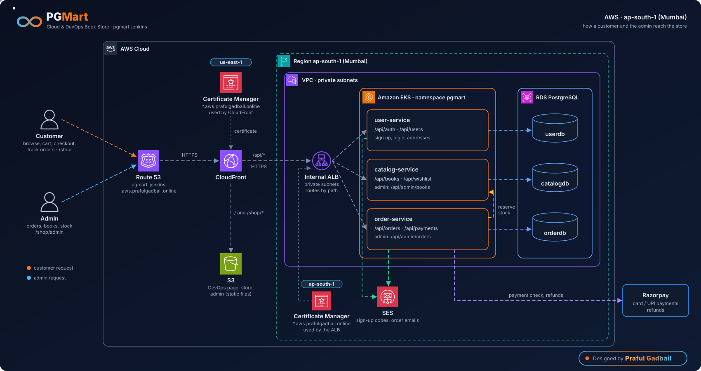

<p align="center">
  
</p>

<p align="center">
  Microservices e-commerce app on AWS EKS.<br>
  Traditional CI/CD with Jenkins, SonarQube, Trivy, Helm and Cluster Autoscaler.
</p>

<p align="center">
  
  
  
  
  
  
  
  
  
</p>

## About

A working online book store (customers order and pay, an admin runs orders and stock) used to show how a real application is built, secured and run on AWS: CI/CD with Jenkins and SonarQube, deployment to Amazon EKS with Helm.

## Architecture



| Step | Where | What happens |
|---|---|---|
| 1 | **Route 53** | `pgmart-jenkins.aws.prafulgadbail.online` points to CloudFront |
| 2 | **CloudFront** | One HTTPS address for the whole site. Its certificate (`*.aws.prafulgadbail.online`) comes from **ACM in us-east-1**, the only region CloudFront accepts |
| 3 | **S3** | `/` (DevOps page) and `/shop/*` (store and admin): static files in a private bucket |
| 4 | **Internal ALB** | `/api/*` reaches the ALB over HTTPS through a CloudFront VPC origin. The ALB sits in private subnets, has no public address, and uses a second certificate from **ACM in ap-south-1**. It sends each path to the right service |
| 5 | **EKS** | user-service, catalog-service and order-service run in namespace `pgmart` |
| 6 | **RDS PostgreSQL** | Each service has its own database: `userdb`, `catalogdb`, `orderdb` |
| 7 | **SES** and **Razorpay** | Sign-up codes and order emails; online payments and refunds |

The ALB is created from the Kubernetes Ingress by the AWS Load Balancer Controller, which makes it internal unless told otherwise. The customer and the admin use the same address; the admin only sees the admin dashboard.

## CI/CD



Jenkins and SonarQube run on their own **EC2 instances**: one for the Jenkins controller, one for the Jenkins agent, one for SonarQube. A push to GitHub calls the Jenkins webhook; the controller hands the build to the agent, which has Docker, Maven, Node, Trivy, Gitleaks, the AWS CLI and Helm. Each service and the frontend has its own `Jenkinsfile` and its own Jenkins job, so a change in one service builds and deploys only that service.

**Backend**: `services/<name>/Jenkinsfile`

| # | Stage | What happens |
|---|---|---|
| 1 | Checkout SCM | Code from GitHub |
| 2 | Secret scan | **Gitleaks**: stops if a password or key was committed |
| 3 | Build and unit test | **Maven**: `mvn verify` |
| 4 | Dependency scan | **Trivy** `fs`: known vulnerabilities in the Maven dependencies (`pom.xml`) |
| 5 | SonarQube analysis | Code quality report sent to **SonarQube** |
| 6 | Quality Gate | Stops the build if SonarQube fails it |
| 7 | Docker build | Image built with **Docker** on the agent |
| 8 | Image scan | **Trivy** `image`: stops on HIGH or CRITICAL |
| 9 | Push to ECR | Image tagged with the Git commit |
| 10 | Deploy to EKS | **Helm** `upgrade` with the service's chart, then waits for the rollout |

After every build, pass or fail, Jenkins emails the result and cleans the workspace.

**Frontend**: `frontend/Jenkinsfile`. No container: Checkout → Gitleaks → `npm ci` → type check and tests → Trivy `fs` → SonarQube and Quality Gate → `npm run build` → upload to S3 → CloudFront invalidation, so visitors get the new version at once.

## Tech stack

| Area | Tools |
|---|---|
| Application | Java 21 · Spring Boot (3 services) · React + TypeScript · PostgreSQL |
| Containers | Docker (multi-stage, non-root) · Amazon ECR |
| Kubernetes | Amazon EKS · Helm · AWS Load Balancer Controller · External Secrets |
| AWS | VPC · Route 53 · ACM · CloudFront · S3 · RDS · Secrets Manager · SES |
| CI/CD | Jenkins (controller, agent) · SonarQube · Trivy · Gitleaks |

## Repository layout

```
services/
  user-service/        Java 21, Spring Boot · src/, pom.xml, Dockerfile
  catalog-service/     same layout
  order-service/       same layout
frontend/              DevOps page and store · React, TypeScript
docs/                  diagrams and logo
local/                 database setup for docker compose
docker-compose.yml     the whole app on a laptop
```